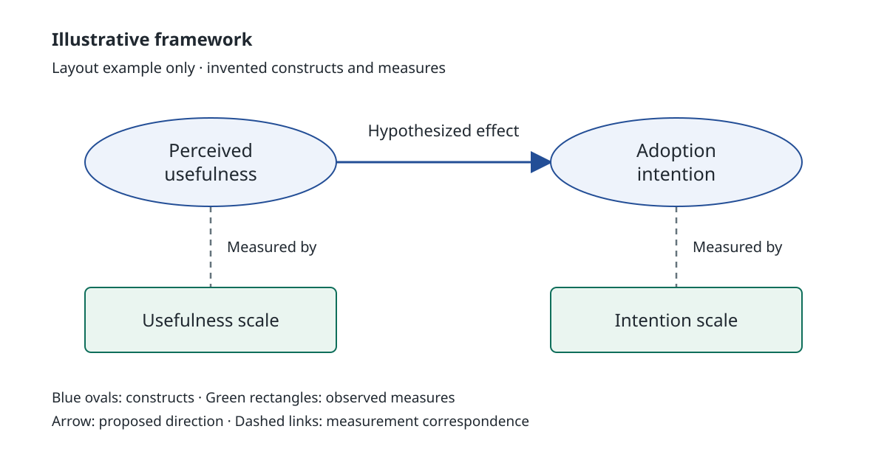

# Scientific figure gallery

Six original teaching examples, with invented data and relationships. These are layout references, not empirical findings or user-approved designs. Each statistical figure has a runnable R script and a vector PDF; the conceptual example is editable SVG. The examples adapt useful ideas from the [PaperBanana review](https://github.com/KaiGu2024/KaiGu2024.github.io/blob/main/docs/skills/visualization/audits/paperbanana-review.md) to our visual standards rather than copying its figures.

## Run and adapt

Run `Rscript path/to/examples/fig_event_study.R` (or another `fig_*.R`) from any directory. Each script writes one PDF beside itself and checks its illustrative data. Install `ggplot2`, `sysfonts`, `showtext`, `curl`, and `jsonlite`; rendering requires internet access to retrieve Lora and Newsreader through Google Fonts. The shared [_setup.R](../examples/_setup.R) loads the canonical [theme_pub.R](../scripts/theme_pub.R); do not copy its theme into each script. On Windows, use a valid UTF-8 locale if your shell supplies an unsupported locale and the project path contains non-ASCII characters.

Replace the toy data with a prepared source artifact and revise the labels and note to match it. Keep each plot's declared export width (7.2 inches here) equal to its intended placement width; adapt geometry for a narrower destination. The embedded PDFs may be scaled by your browser: open them at actual size for inspection. Figure notes below explain the examples and belong outside the artwork.

## Event study: make timing and uncertainty easy to read

[R source](../examples/fig_event_study.R) · [PDF](../examples/fig_event_study.pdf)

<object data="../examples/fig_event_study.pdf" type="application/pdf" width="100%" height="440"><a href="../examples/fig_event_study.pdf">Open event-study PDF</a></object>

Fine navy dots and individual intervals show each period separately; quiet gray references and lighter axes leave attention on the estimates. This is the default event-study style, including smooth-looking paths. The hollow point marks normalization without an estimated interval. Both estimate examples use `theme_pub(style = "estimate")` at their declared 7.2-inch width.

Example note: invented employment coefficients and interval endpoints, in percentage points. Month −1 is normalized to zero and has no estimated interval. The dashed line separates the last untreated and first treated month. No confidence level or clustering method is claimed for these illustrative numbers.

## Coefficients: align the comparison

[R source](../examples/fig_coefficients.R) · [PDF](../examples/fig_coefficients.pdf)

<object data="../examples/fig_coefficients.pdf" type="application/pdf" width="100%" height="440"><a href="../examples/fig_coefficients.pdf">Open coefficient PDF</a></object>

Horizontal intervals share a common scale. Sorting puts the largest estimate at the top, and left-side labels have their own space. One color keeps attention on position and uncertainty rather than making every subgroup a separate visual identity.

Example note: invented subgroup estimates and interval endpoints. Group labels are illustrative; no inferential method is implied.

## Time series: balance lines, markers, and labels

[R source](../examples/fig_time_series.R) · [PDF](../examples/fig_time_series.pdf)

<object data="../examples/fig_time_series.pdf" type="application/pdf" width="100%" height="440"><a href="../examples/fig_time_series.pdf">Open time-series PDF</a></object>

Deeper blue and green distinguish the small marks; white-edged markers stay distinct from the lines. Endpoint names occupy a reserved right-hand space, removing legend lookup. Shape and line pattern distinguish the same groups in grayscale. For denser data, use the marker-thinning recipe rather than adding a marker at every observation.

Example note: invented monthly mean orders per firm for two descriptive groups. These levels do not identify a program effect.

## Grouped comparison: let spacing do the grouping

[R source](../examples/fig_grouped_comparison.R) · [PDF](../examples/fig_grouped_comparison.pdf)

<object data="../examples/fig_grouped_comparison.pdf" type="application/pdf" width="100%" height="470"><a href="../examples/fig_grouped_comparison.pdf">Open grouped-comparison PDF</a></object>

Muted dusty-blue fills suit these broad bars. Rows sit close within each region, with a larger gap between regions. Bars show the gap directly, and endpoint numbers remove interpolation. The common sector ordering is also ascending within each region for these data; if rankings conflict, select a common comparison order explicitly. This is one faceted encoding with a shared scale.

Example note: invented program-minus-comparison gaps in orders per firm. Raw group means are included in the script; the differences are descriptive.

## Heatmap: color for scanning, numbers for precision

[R source](../examples/fig_heatmap.R) · [PDF](../examples/fig_heatmap.pdf)

<object data="../examples/fig_heatmap.pdf" type="application/pdf" width="100%" height="520"><a href="../examples/fig_heatmap.pdf">Open heatmap PDF</a></object>

Square cells and narrow white separators make a compact matrix. Each cell contains its exact share, so a separate color key adds little. This example retains its original higher-share = lighter orientation. Text switches between light and dark according to the fill; that threshold is specific to these values and this palette, not a universal rule.

Example note: invented shares across three usage and spending ranks; the nine cells sum to 100%. They illustrate layout, not an actual quantile calculation. Use the joint-quantile recipe to construct bins from real data.

## Conceptual diagram: separate argument and measurement

[Editable SVG](../../conceptual-framework/examples/measurement-layout.svg)

The proposed relationship runs left to right; the measurements line up below their constructs. Consistent shapes and pale fills distinguish layers, while short connectors leave space for labels. The figure has four node IDs (`n1`–`n4`) and three relationship IDs: `r1` is the proposed `n1` → `n2` effect; `r2` and `r3` link each construct to its measure without arrowheads. This is the complete intended relationship list for checking the SVG.

Use the conceptual-framework skill for source mapping and arrow meanings. This example uses fictional relationships and measures, not a reconstruction of a published paper.

## Where the rules live

- [Visualization entrypoint](https://github.com/KaiGu2024/KaiGu2024.github.io/blob/main/docs/skills/visualization/SKILL.md): plotting standards and final-size acceptance.
- [Recipes](https://github.com/KaiGu2024/KaiGu2024.github.io/blob/main/docs/skills/visualization/references/recipes.md): reusable code patterns beyond these complete examples.
- [Annotations](https://github.com/KaiGu2024/KaiGu2024.github.io/blob/main/docs/skills/visualization/references/annotations.md) and [palettes](https://github.com/KaiGu2024/KaiGu2024.github.io/blob/main/docs/skills/visualization/references/palettes.md): detailed labeling and color choices.
- [Figure review](https://github.com/KaiGu2024/KaiGu2024.github.io/blob/main/docs/skills/visualization/guidance/figure-review.md): planning, reference selection, and revision order.
- [Conceptual visual specification](https://github.com/KaiGu2024/KaiGu2024.github.io/blob/main/docs/skills/conceptual-framework/references/visual-spec.md): diagram composition and implementation.

This gallery explains concrete design choices. It does not add another set of global style rules.
